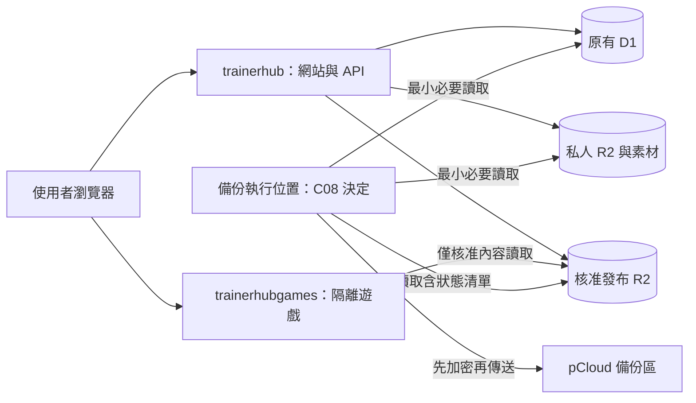

# Cloudflare Workers 搬遷與 pCloud 備份計畫

日期：2026-10-19。狀態：待確認的執行計畫，尚未實作、部署、切換網域或連接 pCloud。

已由擁有者確認的 Worker 名稱：主平台 `trainerhub`，隔離遊戲執行器 `trainerhubgames`。名稱不必再次詢問；正式網域、排程整併、費用與資料外部備份仍依下列節點確認。

本次只授權撰寫計畫。後續 AI 應先完成可在本機準備的程式、測試、候選產物與回退資料，再於相應節點取得具體操作授權。不得把同意本計畫解讀成核准所有正式操作，也不重複詢問已在對話中明確核准且範圍未變的事項。

## 1. 目標與現況

目標是減少部署單位、沿用現有資料、保持遊戲隔離，完成網站搬遷後再啟用可驗證還原的 pCloud 備份。先採現有依賴與平台功能，不同時重寫前端、遊戲引擎或資料模型。

| 項目 | 倉庫目前設定 | 搬遷目標 |
| --- | --- | --- |
| Hub | Pages `rehabtrainerhub`，`apps/rehabtrainerhub/out/` | Worker `trainerhub`，沿用 Next.js 靜態匯出 |
| Runner | Pages `trainerhub-user-games`，`apps/usergamerunner/dist/` | Worker `trainerhubgames`，獨立站點及現有隔離契約 |
| Hub 網域 | `https://trainerhub.cc` | 保留，實際綁定方式於 C02 確認 |
| Runner 網域 | `https://trainerhub-user-games.pages.dev` | 於 C02 決定新 origin 與舊入口相容期 |
| D1 | `REHAB_DB` → `rehab_db` | 沿用原資料庫，不因改名建立空資料庫 |
| R2 | 下表四個 bucket | 沿用原 bucket、key、發布摘要與存取規範 |
| KV | 已停用的 `ARTICLE_CACHE` | 首次搬遷先保留，不順便刪資料 |
| 審核排程 | `workers/game-review-issues`，設定為每分鐘執行 | 是否整併至 `trainerhub`，於 C01 確認 |
| CI/CD | GitHub Actions 驗證後部署 Pages | 沿用同一 repo 與驗證流程，改為部署 Workers |

上述是原始碼設定，不代表已查核 Cloudflare 帳號的實際部署。階段 A 必須比對正式狀態，不能依過期文件推斷 current 或已啟用的排程。

| R2 bucket | 用途 | `trainerhub` | `trainerhubgames` | 備份需求 |
| --- | --- | --- | --- | --- |
| `rehab-storage` | 靜態素材 | 保留現有權限 | 不綁定 | 內容與必要 metadata |
| `oculomotor-data` | 私人眼動 CSV | 保留現有權限 | 絕不綁定 | 加密、限制檔名及清單洩漏 |
| `rehab-game-quarantine` | 私有待審套件 | 保留現有權限 | 絕不綁定 | 作為資料備份，禁止執行其中程式 |
| `rehab-game-releases` | 核准發布及狀態 | 保留既有發布能力 | 僅既有 GET／HEAD 讀取流程 | 包含套件、manifest、current 與撤回狀態 |

40 款遊戲維持現有靜態／R2 發布方式，不各自新增 Worker。Workers 名稱更動不代表要更名 app 目錄、npm workspace、D1 或 bucket。

相關依據：[Hub 設定](../apps/rehabtrainerhub/wrangler.toml)、[Runner 設定](../apps/usergamerunner/wrangler.toml)、[Next.js 設定](../apps/rehabtrainerhub/next.config.mjs)、[遊戲平台部署規範](game-platform-deployment.md)、[審核排程規範](hub-game-review-rollout.md)、[倉庫指引](../AGENTS.md)。

## 2. 部署數量與安全邊界

網站目標固定為兩個 Worker；過渡期的 Pages 與是否保留審核 Worker 必須分開計算，不能承諾切換當天後台立刻只剩兩項。



- 若 C01 核准整併審核排程，`trainerhub` 同時提供 HTTP 與該排程；完成交接後才停用舊排程。其 GitHub App 憑證會集中到 Hub，需接受此權限集中風險。
- 若尚未核准整併，保留只綁 D1 的審核 Worker。不得為了少一個專案，直接讓原審核 Worker 取得私人 R2、登入或 pCloud 憑證。
- 資安優先時，pCloud 備份建議使用既有 repo 的獨立 GitHub Actions 工作，不增加 Cloudflare 專案，也不讓對外 Hub 持有備份憑證。若擁有者希望排程全留 Cloudflare，可於 C08 選擇 `trainerhub` Cron，明確接受公開服務與備份共用信任邊界。
- 模組、檔案或不同 handler 不能形成憑證隔離。備份放進同一 Worker 後，該 Worker 遭入侵就可能危及所有綁定與 secrets。

## 3. 必須向擁有者確認的節點

所有 C01 至 C13 初始均為「待確認」。可一次確認多個節點，但需逐項記錄答案、日期、核准的 commit／產物或操作範圍。核准後直接完成該範圍工作；若網域、資料範圍、費用、權限或產物有實質變更，重新確認受影響的節點。

| 節點 | 何時確認、需回答的問題 | 確認前 AI 必須準備的內容 | 未確認時的處理 |
| --- | --- | --- | --- |
| C01 架構 | 是否將審核排程整併進 `trainerhub`，使最終正式部署為兩個 Worker？ | 兩個與三個部署的權限差異、GitHub App 憑證去向、舊排程交接方式 | 可完成本機轉接；不搬憑證、不停舊排程 |
| C02 網域與 PWA | Hub 是否維持 `trainerhub.cc`？Runner 選哪個獨立站點？舊 PWA 支援多久、能否接受重新安裝？ | 精確 origin、DNS／TLS 所屬帳號、需要變更的 origin 清單、舊 PWA 方案 | 本機使用測試 origin；不改正式 DNS 或 registry |
| C03 權限與環境 | 可使用哪些帳號及憑證來源？是否允許建立隔離測試資源、受控預覽網址？ | 部署／DNS／測試所需的最小權限表、資源及 secret 名稱清單，不含值 | 可繼續測試替身；不申請寬權限、不接正式資料 |
| C04 搬遷前保護 | 是否允許在指定離峰匯出正式 D1、讀取 R2 建立加密回退基準？允許保存在哪裡、多久？ | 資料範圍、匯出阻擋風險、加密方式、暫存清理及還原演練步驟 | 先用合成資料演練；不匯出私人資料 |
| C05 候選部署 | 是否部署指定候選產物至無正式資料的測試環境？ | 精確 commit／產物摘要、bindings、路由、測試報告與預估資源費用 | 不建立外部部署；完成本機候選 |
| C06 正式切換 | 是否在指定時間，以指定候選切換兩站、同步正式 secrets／網域／origin，並更新 `main` 的部署流程？ | 完整差異、正式讀寫驗收資料方案、實際切換順序、回退命令、觸發條件與觀察期 | 不 push 會觸發部署的變更、不綁正式資料或切流量 |
| C07 排程交接 | C01 已選整併時，何時關閉舊審核 Cron 並啟用新 handler？ | D1 工作及 Lease 狀態、單一執行者證據、重試／不重複建 Issue 測試 | 沿用舊執行者；新正式排程關閉 |
| C08 備份方案 | 選 GitHub Actions 或 Hub Cron？pCloud 用哪個區域、帳號／資料夾？備份哪些資料？可接受的月費上限與資料損失／還原時間目標？ | 兩方案風險、權限、容量與 CPU／操作量估算、資料外部保存範圍 | 備份模組可本機開發；不授權 pCloud、不自動升級 Paid |
| C09 pCloud 授權與試傳 | 是否授權指定應用／帳號，僅先用合成資料試傳與驗證？由誰保管復原金鑰？ | OAuth callback、token 實際權限、固定 API host／folder ID、加密格式與金鑰保管說明 | 不要求聊天提供密碼或 token；不連正式資料 |
| C10 首次正式備份 | 是否於指定離峰將核准的正式資料加密傳入指定 pCloud？是否接受匯出阻擋及必要的短暫寫入暫停？ | 試傳、失敗續跑與隔離還原證據；精確來源／目的地、範圍、時間及資料暫存說明 | 不傳正式資料；網站繼續正常運作 |
| C11 自動排程 | 是否啟用指定時區／頻率、保留期限及告警收件方式？是否核准付費或自動清理？ | 首次備份報告、預估費用、失敗告警內容、清理候選清單與保護規則 | 排程與自動刪除維持關閉；告警不寄出 |
| C12 舊環境退役 | 是否停用／刪除列出的舊 Pages、審核 Worker、DNS 及已不需的舊憑證？ | 觀察期結果、舊入口使用情況、PWA 支援期限、回退影響、逐項資源清單 | 保留必要相容入口；不因到期自動刪除 |
| C13 正式資料還原 | 發生資料事故時，是否將指定備份還原到正式 D1／R2？ | 備份完整性、隔離還原結果、受影響紀錄、停寫方案及事故前快照 | 只處理隔離副本；不得自動覆寫正式資料 |

C06 可預先核准「在指定條件下還原路由與程式版本」，避免故障時還要等待第二次詢問；此授權不含 D1／R2 資料還原或刪除。新增付費資源、擴大資料外傳或憑證權限，必須先更新對應確認內容，不能只以費用告警代替授權。

## 4. 階段 A：盤點與回退基準

1. 記錄 Git commit、未提交變更與本次檔案範圍。保留其他工作中的變更，不整棵工作樹部署，也不重設或代替他人提交。
2. 經 C03 核准的讀取權限，盤點正式 Pages 部署 ID、網域／DNS／TLS、D1 UUID、R2 bucket、KV、Cron、GitHub App、OAuth callback、Turnstile hostname 及 CI 環境。只記 secret 名稱與來源，不讀印值。
3. 記錄十款 R2 遊戲的正式 current、核准 manifest 及收據，確認未遷移遊戲的原路徑與流程。搬遷不發布新遊戲版本、不改既有 contentSha256 或 current。
4. 列出回退可用的原部署、原網域綁定、原 origin、舊 CI 與 secrets 取得管道，驗證可以重新提供服務。
5. C04 後建立加密 D1 匯出與 R2 回退清單，包含檔案與 metadata；mutable 狀態物件須有可復原版本。若要寫入 R2 暫存，需核准精確 prefix，不混入核准發布區或公開素材。
6. 在隔離資料庫／本機完成還原演練，驗證 schema、外鍵、筆數與 D1 引用的 R2 檔案。若匯出遇到虛擬資料表或大型整數精度限制，提出替代方式；不能為了匯出刪正式資料表或修改原值。

D1 官方文件指出執行匯出時會阻擋其他資料庫請求，故正式資料匯出必須安排離峰並量測影響。[D1 匯入／匯出限制](https://developers.cloudflare.com/d1/best-practices/import-export-data/)

## 5. 階段 B：先測試，再建立 Workers 候選

### 5.1 設定與 HTTP 入口

- 保留 Hub 的 `output: 'export'`、尾斜線、404、canonical、robots、sitemap、manifest 與現有遊戲輸出。此次不引入 SSR 或新的 Next.js adapter。
- Worker 設定名稱分別固定為 `trainerhub`、`trainerhubgames`；將 Pages 輸出目錄轉為 `assets.directory`，補上 `main` 與供靜態轉接使用的 `ASSETS` binding。`ASSETS` 不可與 Hub 現有的 R2 `ASSET_BUCKET` 混淆。
- 優先用官方 `wrangler pages functions build` 編譯既有 Functions；先以測試驗證 method handler、動態參數、middleware、`next()` 與靜態 fallback。只有實際不相容部分才補轉接，不同時更換路由框架。[官方轉換方式](https://developers.cloudflare.com/workers/static-assets/migration-guides/migrate-from-pages/)
- Worker bundle、source map、設定、secret、備份及 `functions/` 原始碼不得成為公開靜態資產；建立產物 allowlist 與必要的 `.assetsignore`，測試敏感路徑確實不可下載。
- 初次保留原 compatibility date／flags，避免一次變更部署平台與 runtime 行為；若轉換要求調整，另列實際差異及回歸結果。

### 5.2 資產順序與既有安全檢查

先寫實際 HTTP 測試，重現 Worker 預設資產優先造成的差異，再設定需要 `run_worker_first` 的路徑。不能只把 `_routes.json` 原檔複製過去就宣稱等價。

- Hub 退役 hostname 的 301、已遷移遊戲舊 JSON／JS／SW／manifest 的 410／no-store，必須在資產讀取前生效。
- 未遷移遊戲、預覽圖、API、靜態頁、尾斜線、deep link、404 與 405 維持既有行為；未知 API 不得回 200 HTML。
- Runner 的 `/games/*`、兩版眼動代理與需要修改回應的路徑，保持正式 handler 與標頭；`/runtime/*` 等可直接提供的靜態資產沿用既有 CORS、MIME 與快取。
- 核准狀態、manifest allowlist、hash、版本固定 session、撤回與檔案安全檢查，不可被資產優先或快取略過。缺檔／狀態不明時拒絕提供遊戲。
- `_headers`／`_redirects` 與程式產生的回應分別驗證；動態 CSP、Permissions-Policy、跨來源資源標頭不能只靠靜態檔設定。
- 在保持上述行為的條件下，才讓不需執行程式的靜態資產直接提供。過度使用 Worker 優先會增加動態請求計量。[Worker 與資產路由](https://developers.cloudflare.com/workers/static-assets/routing/worker-script/)

### 5.3 身分、預覽與遊戲隔離

- `trainerhubgames` 必須使用與 Hub 不同的站點；不得使用 `games.trainerhub.cc`，也不加入 `AUTH_ALLOWED_ORIGINS`。Worker 名稱不等於完整 `workers.dev` hostname，C02 需記錄實際網址。[既有隔離規範](game-platform-deployment.md)
- 維持 `sandbox="allow-scripts"`、opaque origin、私有 MessageChannel、nonce／sequence、能力白名單與輸入代理權限。不增加 `allow-same-origin`、對外連線或 top navigation。
- Runner 不配置 D1、KV、quarantine、私人 CSV、登入、GitHub App、部署 token 或 pCloud secrets。現有 R2 binding 沒有可宣告的唯讀開關；依程式測試與部署審查維持僅讀，不聲稱有平台強制唯讀隔離。
- Hub 沿用 session／state secrets、簽章契約與正式 origin，維持 Cookie、CSRF、OAuth state、角色／擁有者授權、Turnstile、冪等保存及輸入驗證。不要把換平台當成關閉驗證的理由。
- 預覽只用隔離資料與 secrets，預設無正式 Cron、無正式 D1／R2、無正式 GitHub Issue 或 pCloud 寫入。若測試站有非公開資料，以存取控制保護；`noindex` 不能代替授權。
- 正式 Hub 只接受核准 hostname；未使用的 `workers.dev`／版本預覽入口關閉或受控保護，避免額外入口繞過正式網域的存取政策。Runner 僅保留 C02 核准的公開入口。
- `NEXT_PUBLIC_`／`VITE_` 僅限確認可公開的值。部署腳本採明確 allowlist；build variables 與 runtime secrets 分開，不盲目複製所有 Pages 環境變數。

### 5.4 CI/CD

- 檢查 `scripts/pages-apps.mjs`、`write-pages-env.mjs`、`gamehost-environment.mjs`、`build-apps.mjs`、`deploy-cloudflare-pages.mjs`、`sync-cloudflare-auth-env.mjs`、`sync-cloudflare-pages-domains.mjs`、部署範圍判斷、root scripts 與兩份 workflow 的所有呼叫者，逐項轉換其實際契約。
- 沿用 `npm ci --workspaces --include-workspace-root`、兩份 workflow 相同的七項驗證與 root 命令。Workers 部署／排程／備份測試接入相應既有 gate，不任意增加 matrix 或 Linux Brave CI。
- 保留「純文件不觸發 CI」「僅已遷移 R2 遊戲內容不部署平台」及「平台變更必須驗證」；官方 R2 發布仍需精確 version／contentSha256 核准。
- 依目前 AGENTS 僅在 `main` 工作，不另開功能分支。`main` 的應用／workflow 變更會觸發現有部署，故 C06 前先準備候選及部署切換保護，不以未審查的 push 測試正式流程。
- 初期保留舊部署定義供回退；任一正式站點同時只能有一個有效部署來源，避免 Pages 與 Workers 流程互相覆蓋。

## 6. 階段 C：候選驗證、正式切換與 PWA 過渡

### 6.1 驗證要求

所有功能與轉接先測試失敗，再實作通過，保存 RED 原因、GREEN 結果及回歸證據。下列是後續執行要求，本計畫不代表測試已通過：

```text
npm run test:naming
npm run test:pwa
npm run test:game-architecture
npm run test:hub-functions
npm run test:gamerunner
npm run test:entrypoints
npm run test:cloudflare-deploy
npm run build:hub
npm run build:gamerunner
```

新增 Worker 後還需驗證實際編譯入口與本機 HTTP 行為，不能只通過直接 import Function 的單元測試。修改的 JS 執行 `node --check`；SEO／manifest 受影響時補相關 gate。

本機 Brave 覆蓋 Hub 訪客與登入、角色／管理／投稿安全拒絕、十款 R2 與未遷移遊戲、完整開始／完成／保存重試／退出、桌機／手機／平板、雙語、全螢幕與相機拒絕／斷線。PWA 驗證安裝、離線、更新及舊路徑；撤回測試只用本機或隔離 fixture，不撤回正式遊戲。

驗收報告區分模擬裝置與實體硬體，不聲稱已驗 Safari／iOS、真人相機或音訊硬體。正式讀寫驗收用 C06 核准的既有測試身分與標記資料，不擅自新增正式帳號、假訓練紀錄或操作真實使用者資料。

### 6.2 切換順序

1. C05 後，以固定候選產物完成隔離環境的 HTTP、安全標頭與瀏覽器驗證，生成兩站版本 ID、SHA-256、binding 清單及回退操作表。
2. C06 前核對備份、DNS／TLS、OAuth、Turnstile、secrets 的安全移交與舊入口方案。無法從 Pages 讀回的 secret，從擁有者既有保管或 CI 管道重設相同值；不得先換成隨機新值造成 session 失效。
3. C06 後先提供可工作的 `trainerhubgames` 與新 origin，維持舊 Runner 服務；核對 current、版本 session、公開核准 bytes、runtime、感測代理、manifest／SW 及錯誤拒絕。
4. 再以同一核准候選切換 `trainerhub.cc` 到 `trainerhub`。同步 Hub server 的 `GAME_RUNNER_ORIGIN`、registry 與前端所需 origin，確保新 Hub 不指向尚未就緒的 Runner。移除衝突的 Pages 綁定前已備妥精確復原步驟。
5. 在新舊部署可能並存的短暫期間，維持資料與 API 相容、不執行破壞式 migration，並保持寫入冪等；若無法證明安全共用，於 C06 核准維護窗口內切換。
6. C07 後才交接審核 Cron：關閉舊排程、等待已領取工作完成或 Lease 到期、核對狀態、啟用新排程。保留原 Lease／重試／Issue 找回規則，不靠假設 Cron 恰好只執行一次。
7. 依 C06 約定的觀察期監測登入、5xx、API 延遲、成果保存、遊戲載入、舊入口、Cron 失敗與用量；遷移穩定後才進入正式 pCloud 備份階段。

### 6.3 舊 Runner 與已安裝 PWA

換 origin 不會移轉 localStorage、IndexedDB、Service Worker 或安裝狀態。301／302 只能導流，不能當成 PWA 或本機設定搬遷證據。

- C02 選定新獨立站點後，維持原遊戲路徑與版本契約；同步 Hub registry、server／build origin、runtime URL、測試 fixture、CSP 與跨來源設定，避免全域字串取代。
- 既有 PWA 的執行與更新端點在相容期內繼續回應。若採舊 Pages 作反向代理，僅允許核准路徑與 GET／HEAD、固定上游，保留撤回檢查、動態安全標頭、內容與 query 契約；不得代理 Hub 私人 API。
- 新舊 origin 的執行行為與舊 SW 快取須實測；若固定版本資產或 SW 的不可變契約不容修改，保留原 bytes，另於可更新入口提供移轉提示。
- 若改採通知重新安裝，先交代哪些本機設定無法沿用並取得 C02 同意，不自動刪舊快取。相容期內要能維持核准狀態／撤回處理；離線裝置仍可能使用既有快取，此限制須揭露。
- C12 前不得刪除舊 Pages；後台暫時多出相容專案是保護既有使用者的過渡成本。

## 7. 階段 D：搬遷完成後連接 pCloud

### 7.1 執行位置與憑證

| 方案 | Cloudflare 專案數影響 | 憑證與主要風險 | 適用條件 |
| --- | --- | --- | --- |
| 獨立 GitHub Actions 備份工作，資安優先建議 | 不新增 Worker | 備份憑證不在對外網站；仍需保護 repo、workflow 及執行供應鏈 | 接受排程可能延遲，搭配備份新鮮度告警 |
| `trainerhub` 的 `scheduled()` | 不新增 Worker | Hub 同時持有 pCloud／D1 匯出憑證，攻擊影響範圍較大 | C08 明確接受此風險，且實測 CPU／時間／操作量足夠 |

GitHub 備份使用獨立 workflow 與 secrets 範圍、`contents: read`、同一份備份工作的併發鎖；僅受信任的 `main` 排程或核准的手動觸發可取用。不可在 fork／不受信任 PR 執行，工具及 action 固定版本或完整 commit，不能為備份執行投稿套件。保留排程的時區設定與新鮮度檢查；公開 repo 長期無活動可能停用排程。[GitHub 排程限制](https://docs.github.com/en/actions/reference/workflows-and-actions/events-that-trigger-workflows#schedule)

Hub Cron 只由排程入口驅動；不新增可讓匿名使用者指定 bucket、下載 URL、目的地或還原動作的 HTTP endpoint。每次有大小／物件數／時間上限、持久 checkpoint、Lease 與有限重試，避免併發重複備份拖垮網站。長時間工作超出限制時，先提供量測及方案讓擁有者決定，不自動增加 Worker、Queue、Workflow 或付費資源。

部署憑證、備份憑證、清理／還原憑證分離。外部讀取 R2 優先採 S3 Object Read only，限制到核准 bucket；這與 Worker binding 的程式唯讀不同。[R2 token 權限](https://developers.cloudflare.com/r2/api/tokens/)

D1 匯出使用專用 token 與匯出端點可用的最小權限，先測試實際授權範圍並記錄。不能假設限制程式內的 database ID 就限制了 token；若平台只支援較大的帳號範圍，C08 必須交代殘餘風險。禁止沿用可部署、改 DNS 或刪資源的總權限 token。token 放在選定執行環境的 secrets，不能進 bundle、Git、issue、CI artifact 或日誌。

### 7.2 pCloud 授權與連線

1. C08 確認帳號、容量、資料區域、固定備份 folder ID、資料外部保存範圍與金鑰保管人；私人 CSV／帳號資料必須明列，不以「靜態素材」概括。
2. 優先使用專用備份帳號。只有資料夾路徑／folder ID 的程式限制，不能證明 OAuth token 只能讀寫該資料夾；官方 OAuth 文件未列出可直接假定的單一資料夾 scope。若只能授權個人帳號，C09 必須讓擁有者確認實際可觸及的個人資料範圍。
3. 採伺服器端 Authorization Code flow，callback 固定且驗證一次性 state、來源管理員身分與有效期。亦可用受控的本機工具完成一次性授權，不為連接帳號新增公開通用 callback。不要索取帳號密碼、2FA 復原碼或把 token 貼進聊天。[pCloud OAuth](https://docs.pcloud.com/methods/oauth_2.0/authorize.html)
4. 美國只允許 `api.pcloud.com`，歐洲只允許 `eapi.pcloud.com`。驗證 OAuth 回傳 hostname 必須在此 allowlist，與核准區域相符；不得把它當成任意 URL 直接 fetch。限制重導向、逾時與重試，避免 SSRF 或憑證跟隨跨 host 重導向。[pCloud 區域](https://docs.pcloud.com/)
5. 使用受支援的授權傳遞方式，避免 token 放進可記錄的 URL。callback code、完整授權標頭、D1 signed URL、CSV 內容及 token 都需從存取／錯誤日誌遮蔽。
6. C09 後只以合成 SQL、合成 CSV、假套件完成上傳、下載、checksum、錯誤、撤銷及重新授權演練，確定實際 quota 與 API 行為再進 C10。

### 7.3 加密與檔案配置

- 在離開受控執行環境前加密內容及含私人 key 的 manifest。TLS 與 pCloud 儲存加密不能代替此步，也不假定一般 API 上傳會自動進入 pCloud Crypto。
- 選成熟、有完整性驗證、固定版本且可在另一台電腦還原的格式／工具。外部執行可優先評估公開金鑰加密格式，使排程只持有加密公鑰、復原私鑰由擁有者離線保管；Worker 方案必須先驗證相容實作，不能為了適配而自行發明加密協定。
- 復原私鑰不得只存在 Cloudflare 或同一份 pCloud 備份；首次正式備份前先用合成資料驗證離線金鑰可解密。金鑰輪替須保留仍在保留期內備份需要的舊金鑰。
- 用 run ID／不含個資的物件 ID 命名，避免檔名洩漏 Subject ID、姓名或原始私人 key。若需暫存明文，僅在已核准的受控暫存區，作業結束即清除；失敗路徑也清除，不上傳 CI artifact。
- 以串流或有界分塊處理，不把整個 bucket／SQL／ZIP 載入記憶體。分塊必須由成熟格式保證排序、完整性及重組，未完成的上傳不能被視為可還原備份。

建議邏輯配置如下；`.enc` 代表 C09 確認的加密格式，實作時記錄具體格式／版本：

```text
<approved-folder>/<backup-id>/
  database/rehab_db.sql.enc
  objects/<opaque-object-id>.enc
  manifest.json.enc
  COMPLETE.json
```

manifest 保存備份起訖／cutoff、D1 匯出 bookmark、schema／來源 commit、bucket／原 key、大小、SHA-256、ETag、必要 metadata、pCloud file ID、加密格式及恢復順序。公開可見的 `COMPLETE.json` 僅含不涉個資的識別與摘要，整份清單驗證後最後才產生；標記本身不能代替解密及內容驗證。

每次成功 manifest 的摘要與時間另存於權限獨立的受控紀錄，用來辨識備份被替換或回滾。能解密不代表內容一定來自可信備份工作，尤其公開加密金鑰不能證明上傳者身分；有來源簽章需求時採成熟簽章格式，簽署金鑰與 pCloud 帳號權限分開保管。

### 7.4 備份流程與一致性

1. 取得備份 Lease，產生唯一 backup ID；防止同一份工作因重試同時執行。先檢查 pCloud 剩餘容量與來源用量。
2. 經 D1 Export API 啟動匯出、以 bookmark 輪詢取得 SQL。下載只信任官方回應的預期 HTTPS 來源，不記 signed URL，過期重新取得，不改為公開下載。[D1 匯出 API](https://developers.cloudflare.com/api/resources/d1/subresources/database/methods/export/)
3. D1 每次備份完整 schema 與資料；先量測匯出阻擋。R2 首次全量，以後增量，資料版本與每次快照清單分開保存；不能只留一份會覆寫的鏡像。
4. 列舉 R2 物件並驗證讀取時版本；來源讀取期間有變更時重新讀取／重試，不能只憑列舉時的大小判定成功。核准發布 bytes 不變，mutable manifest／current／撤回狀態每次保留快照。
5. D1 與 R2 沒有共同原子快照。以匯出時點及物件版本對帳 D1 引用；缺檔、讀取競態或狀態不一致時標記失敗，不產生完成標記。若需要嚴格同時點恢復且無法保證，於 C10 核准短暫停寫窗口，不能自行停站。
6. 加密上傳至固定 folder ID，使用不覆寫既有快照的命名與冪等規則。pCloud `uploadfile` 預設同名可覆寫，需明確阻擋非預期覆寫並使用 `nopartial` 避免斷線殘檔被接受。[上傳行為](https://docs.pcloud.com/methods/file/uploadfile.html)
7. 驗證上傳大小及 checksum；pCloud 美國與歐洲提供的雜湊種類不同，不能固定要求兩區都回 SHA-256。還原時以自行記錄的 SHA-256 及加密完整性驗證原始資料，不把 R2 multipart ETag 當成內容 SHA-256。[pCloud checksum](https://docs.pcloud.com/methods/file/checksumfile.html)
8. 完成 manifest 與完成標記、保存無個資的統計與 checkpoint；失敗時有界重試，不能覆蓋上一份成功備份。
9. C10 的首次正式備份必須執行隔離還原與對帳。定期排程後以約定頻率再做完整還原，不能只看「上傳成功」。

### 7.5 頻率、保留、告警與刪除

下列為建議初值，需 C08／C11 核准，不代表已啟用：每日離峰備份 D1 及 R2 增量，暫以可回復最近 30 天評估容量；備份資料損失目標先按 24 小時討論，實際還原時間於演練後訂定。C11 記錄 `Asia/Taipei` 與 UTC 對照，Cloudflare Cron 使用 UTC。[Cron 時區](https://developers.cloudflare.com/workers/configuration/cron-triggers/)

- 容量估算包含 SQL 膨脹、加密開銷、首次全量、變更版本、套件歷史及保留期。原始 R2 未滿免費容量，不代表 pCloud 能容納多份全量。
- 增量清理先計算所有保留 manifest 仍引用的物件，不能單純刪除日期較早的底層物件。至少保留最後一份已驗證可還原的完整集合。
- 初期只產生清理報告、不自動刪除；C11 另外核准精確刪除規則與權限，還原也使用臨時獨立憑證。來源誤刪不立即傳播到備份。
- C08 同時確認私人資料的備份保留及刪除處理方式；另行保全已刪資料與遊戲撤回的必要狀態紀錄，避免舊備份還原後重新公開或恢復已撤銷的權限。
- 告警包含未完成、連續失敗、備份過期、容量不足、授權失效、異常資料量／操作量；只帶 run ID、狀態與統計，不附私人 key、CSV 或 token。通知管道與收件人經 C11 核准後才啟用。
- token 可寫入通常也可能有刪除能力；程式不刪除、版本命名與 pCloud revisions 都不等於不可變備份。若要抵抗帳號遭入侵後刪光備份，另保留離線／獨立權限副本，或經確認採用具保留鎖定能力的目的地，不宣稱目前方案能消除此風險。

## 8. 用量與費用控制

已知目前為免費方案且 D1／R2 尚未達上限；不能據此假設備份運算也一定免費。

- 相同工作流下，Pages Functions 與 Workers 的動態計價相同，直接提供的靜態資產免費。每月 1,000 人、每人 10 次、每次 20 個動態請求的示例是 20 萬次／月；流量分布與 CPU 等仍需另檢查。這是估算，不是正式流量量測。[Workers 定價](https://developers.cloudflare.com/workers/platform/pricing/)
- Workers Free 每次 Cron CPU 10 ms、對外子請求 50 次，記憶體 128 MB；Cron 總執行時間最多 15 分鐘。需要有界分批，不能把「等待網路不算 CPU」當成無限制執行。[Workers 限制](https://developers.cloudflare.com/workers/platform/limits/)
- 如需 Paid，帳號最低 US$5／月，兩個 Worker 不各收一次最低月費；仍可能另有用量超額、D1、R2 或其他產品費用。沒有擁有者核准不得自動升級。
- R2 對外流量免費，但備份讀取／列舉耗用操作額度，Infrequent Access 另有取回費；執行時核對各 bucket storage class，不直接套 Standard 假設。[R2 定價](https://developers.cloudflare.com/r2/pricing/)
- 免費額度為相應帳號／產品的共享額度，不因拆兩個 Worker 而翻倍。設定預算告警及作業上限；告警本身不是硬性帳單上限。

## 9. 風險、阻擋條件與回退

| 風險 | 必要防護／未通過時處理 |
| --- | --- |
| 新部署繞過安全 middleware | 實際 HTTP 測試涵蓋 410、API、撤回及感測代理；不通過不切換 |
| 遊戲與帳號信任邊界合併 | 保留獨立站點、嚴格 sandbox、最少 bindings；任何私人 binding 出現在 Runner 即停止 |
| 預覽取得正式資料或排程寫入 | 隔離資源、secret allowlist、預設排程關閉；發現洩漏撤銷憑證並重新建立候選 |
| 改名誤建空 DB／bucket | 部署前比對原資源 ID；缺少 binding 時拒絕啟動相關功能，不回退到公開桶 |
| 舊 PWA 或快取失效 | 保留舊入口、驗證兩 origin、明確相容期與使用者處置方式 |
| 雙排程／雙部署產生重複副作用 | 唯一部署來源、Lease／冪等、交接等待；暫停新執行者以保留舊流程 |
| pCloud token 或備份金鑰洩漏 | 分離憑證、先加密、私鑰離線、遮蔽日誌；撤銷 token，檢查外傳／刪除範圍，不只重跑備份 |
| 備份不完整或資料競態 | 版本／checksum／引用對帳與隔離還原，不完成就不寫完成標記 |
| 備份造成網站卡住或超額 | 離峰匯出、批量／CPU／時間上限、容量與新鮮度告警，必要時停用備份保持網站運作 |
| 回退造成資料倒退 | 程式／路由回退沿用目前資料，不自動套舊快照；正式資料還原另走 C13 |

正式切換前至少演練一次：停新 Cron → 將 Hub 路由／網域還原原 Pages 部署 → 還原原 Runner origin 與相容的 Hub 產物 → 核對登入、遊戲與保存 → 視需要恢復唯一舊排程。以 C06 的精確資源與操作表執行，不能臨時推測 DNS 設定。

C06 應約定回退觸發條件與可接受的錯誤／延遲門檻：任何資料外洩、授權繞過、錯寫資源或遊戲隔離失效立即處置；持續登入／保存／遊戲啟動失敗依核准門檻回退。若發生憑證洩漏，先撤銷受影響憑證並封鎖入口，不能回退舊程式後繼續使用外洩值。

涉及 D1／R2 還原時，先隔離還原並評估新資料損失，再取得 C13 核准；資料庫還原可能取消進行中的請求。D1 Time Travel 作為另一層保護，免費／Paid 的回復窗口不同，不能取代帳號外備份。[D1 Time Travel](https://developers.cloudflare.com/d1/reference/time-travel/)

正式資料還原後先保持受控流量，對照最新撤回／刪除紀錄、帳號角色與核准發布摘要，再開放服務。備份中的 session／token／帳號狀態可能過時；C13 必須包含會話撤銷或憑證輪替的處置，不因資料能匯入就自動恢復所有存取權。

## 10. 完成與交付條件

- [ ] `trainerhub`／`trainerhubgames` 名稱、正式 origin、資源映射與部署來源已核對。
- [ ] 所有安全邊界、原功能、API、十款 R2 及未遷移遊戲回歸通過，結果與限制有證據。
- [ ] 已保存兩站正式版本 ID、commit、產物摘要、測試結果、回退操作與擁有者確認紀錄。
- [ ] 沿用 D1／R2，沒有不明資料寫入、遊戲重新發布或 current 變更。
- [ ] 舊 PWA 相容方案已驗證，舊資源依 C12 逐項處理；需繼續保留者明列原因。
- [ ] 審核排程維持唯一有效執行者，原 Lease／重試與權限規則保留。
- [ ] pCloud 授權範圍、來源／目的地、加密、金鑰保管、首次備份與隔離還原完成。
- [ ] C11 已確認頻率、保留、告警、費用及是否清理；未核准項目保持關閉並明確記錄。
- [ ] 執行結果另存 `docs/workers-migration-report.md`，不將本計畫的待辦勾選誤當成正式驗收。

確認紀錄格式，執行時逐項填入：

| 節點 | 擁有者答覆／日期 | 核准的 commit、產物與操作範圍 | 證據位置 | 結果 |
| --- | --- | --- | --- | --- |
| C01 至 C13，各自一列 | 待確認 | 待確認 | 尚無 | 未執行 |

本文件只提出方案與後續驗證要求。尚未測得實際備份 CPU、流量、pCloud 容量、故障回復時間或使用者實體裝置表現，不承諾零風險、零停機或一定維持零費用。
